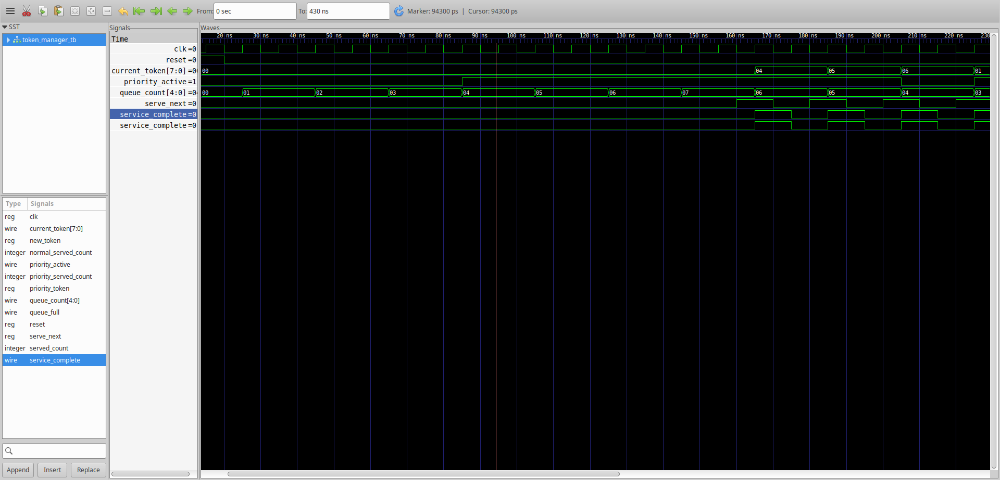

# Priority-Based Digital Token Manager

**Priority-Based Digital Token Management with Anti-Starvation Scheduling for VSDBabySoC**

## Project Overview

This project implements a digital token management system using Verilog HDL. It manages token requests through priority-based scheduling while addressing starvation in normal-priority requests.

## Design Modules

- `RTL/token_manager.v` — Top-level token management module.
- `RTL/token_generator.v` — Token generation logic.
- `RTL/priority_queue.v` — Priority queue logic.
- `RTL/normal_queue.v` — Normal queue logic.
- `RTL/priority_scheduler.v` — Scheduling logic.
- `TB/token_manager_tb.v` — Verilog testbench.

## Tools and Technologies

- Verilog HDL
- OpenROAD-flow-scripts
- Sky130HD standard-cell platform
- KLayout
- Git and GitHub

## Physical Design

The design has been processed through the OpenROAD physical-design flow.

- [Physical Design Documentation](physical_design/README.md)
- [Final GDS Layout](physical_design/layout/6_final.gds)
- [Chip Layout Image](physical_design/layout/chip_layout.png)
- [Physical Design Reports](physical_design/reports/)

## Physical Design Area and Timing Results

The design was implemented using the OpenROAD flow with the Sky130HD platform.

- **Final design area:** 8,423 µm²
- **Final utilization:** 35%
- **Final reported TNS:** 0.00 ns
- **Formal equivalence:** Passed — no difference was found.

For detailed stage-by-stage area and timing results, see the [Physical Design Area and Timing Summary](physical_design/reports/area_summary.md).

Original OpenROAD stage logs and timing reports are available in [`physical_design/reports/stages/`](physical_design/reports/stages/).

## Verification

The available final logic equivalence check reports that no difference was found between the compared netlists.

## Simulation Results

Functional simulation was performed to check the behavior of the token management system under different request and scheduling conditions.

### Simulation Log
[View Simulation Results](simulation/results/token_manager_simulation.log)

The simulation log records the testbench results for token service, priority-based service, normal service, queue status, and anti-starvation test scenarios.

### Simulation Waveform
[View Simulation Waveform (VCD)](simulation/waves/token_manager.vcd)

The Value Change Dump (VCD) file contains signal transitions captured during simulation. It can be opened using a waveform viewer such as GTKWave to inspect request signals, scheduler behavior, and token outputs over time.

### GTKWave Screenshot

The waveform screenshot shows key signals including the clock, reset, current token, priority activity, queue count, and service completion.

[Read the GTKWave Waveform Explanation](simulation/waves/waveformexplanation.md)

