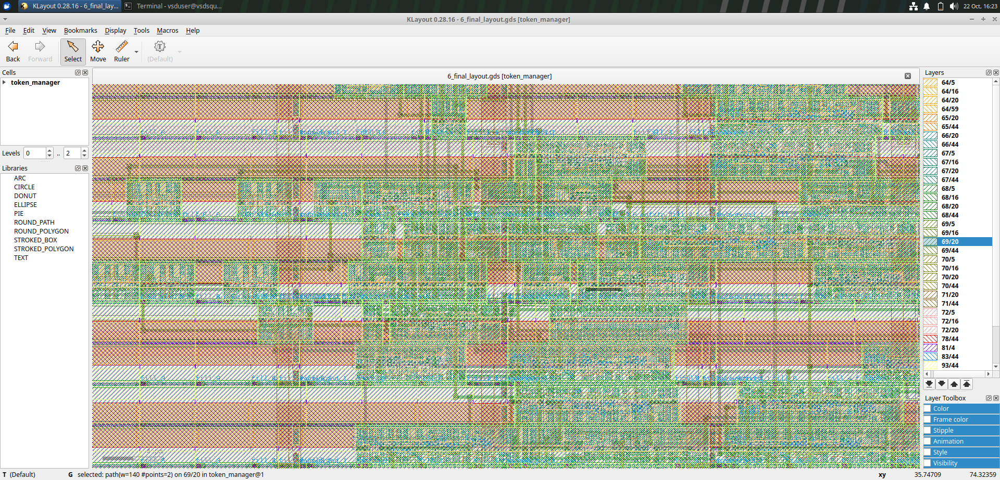

# Priority-Based Digital Token Manager

**Priority-Based Digital Token Management with Anti-Starvation Scheduling for VSDBabySoC**

## Physical Layout




## Project Overview

This project implements a digital token management system using Verilog HDL. It is designed to manage token requests using priority-based scheduling, with an anti-starvation mechanism intended to prevent lower-priority requests from waiting indefinitely.

The design is organized into separate RTL modules and has been taken through the OpenROAD physical-design flow using the Sky130HD standard-cell platform.

## Design Modules

The RTL source directory contains the following modules:

- `token_manager.v` — Top-level token management design.
- `token_generator.v` — Token generation logic.
- `priority_queue.v` — Priority queue logic.
- `normal_queue.v` — Normal queue logic.
- `priority_scheduler.v` — Priority scheduling logic.

The testbench is located at `TB/token_manager_tb.v`.

## Tools and Technologies

- Verilog HDL
- OpenROAD-flow-scripts
- Sky130HD standard-cell platform
- KLayout for viewing the GDS layout
- Git and GitHub for version control

## Physical-Design Results

The design was processed through the OpenROAD flow, including synthesis, floorplanning, placement, clock-tree synthesis, routing, and final reporting.

| Metric | Recorded result |
|---|---:|
| Synthesized cell area | 7,359.56 µm² |
| Final reported design area | 8,423 µm² |
| Final reported utilization | 35% |
| Final GDS layout | `layout/6_final.gds` |
| Formal-equivalence log | `reports/physical_design/6_final_lec.log` |

The synthesis area and final reported design area are from different stages of the flow, so they should not be interpreted as the same measurement.

The final timing report is available at `reports/physical_design/6_finish.rpt`. Consult this report for timing results and design checks.

## Verification

The final formal-equivalence log ends with **“No difference was found.”** This records the equivalence check performed by the flow between the compared netlists.

This result is separate from functional verification. Testbench results should be reviewed independently.

## Repository Structure

```text
PD-token-manager/
├── RTL/
│   ├── normal_queue.v
│   ├── priority_queue.v
│   ├── priority_scheduler.v
│   ├── token_generator.v
│   └── token_manager.v
├── TB/
│   └── token_manager_tb.v
├── reports/
│   └── physical_design/
│       ├── 6_finish.rpt
│       ├── 6_final_lec.log
│       └── synth_stat.txt
├── layout/
│   └── 6_final.gds
└── README.md
```

## Viewing the Layout

Open the final GDS file using KLayout:

```bash
klayout layout/6_final.gds
```

## Current Status

- RTL source files are present in the repository.
- A testbench is present.
- OpenROAD physical-design results have been generated.
- Final timing and synthesis reports have been copied into the repository.
- The final GDS layout has been copied into the repository.
- Additional documentation and functional-verification evidence can be added as the project develops.

## Repository

GitHub: https://github.com/vaishnavibhagoni/PD-token-manager

