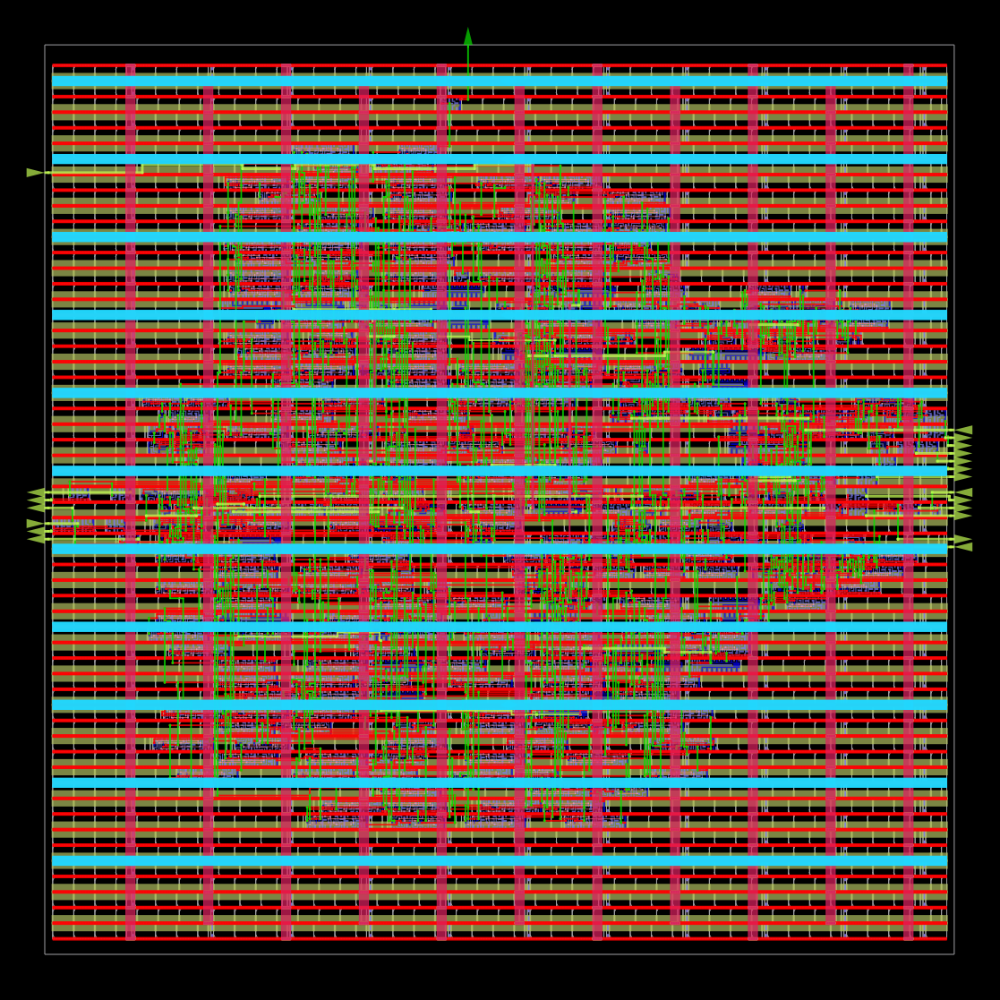
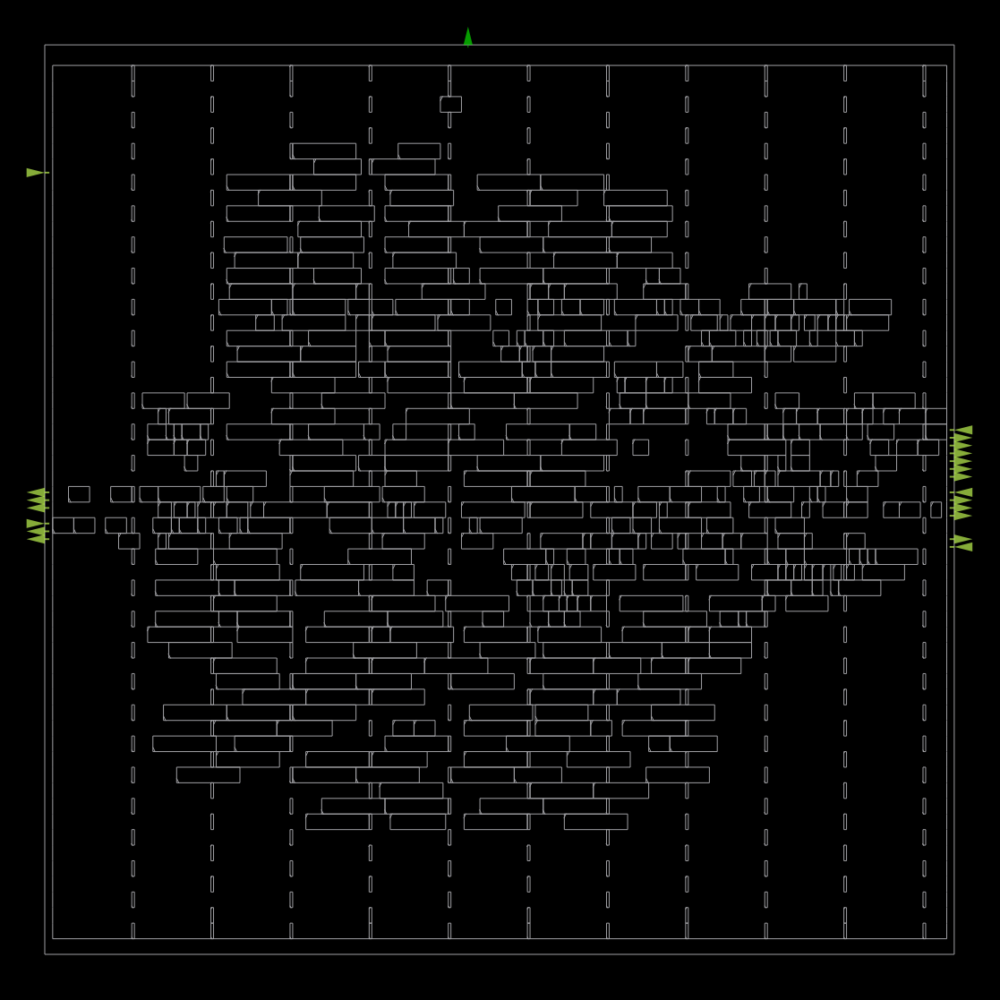
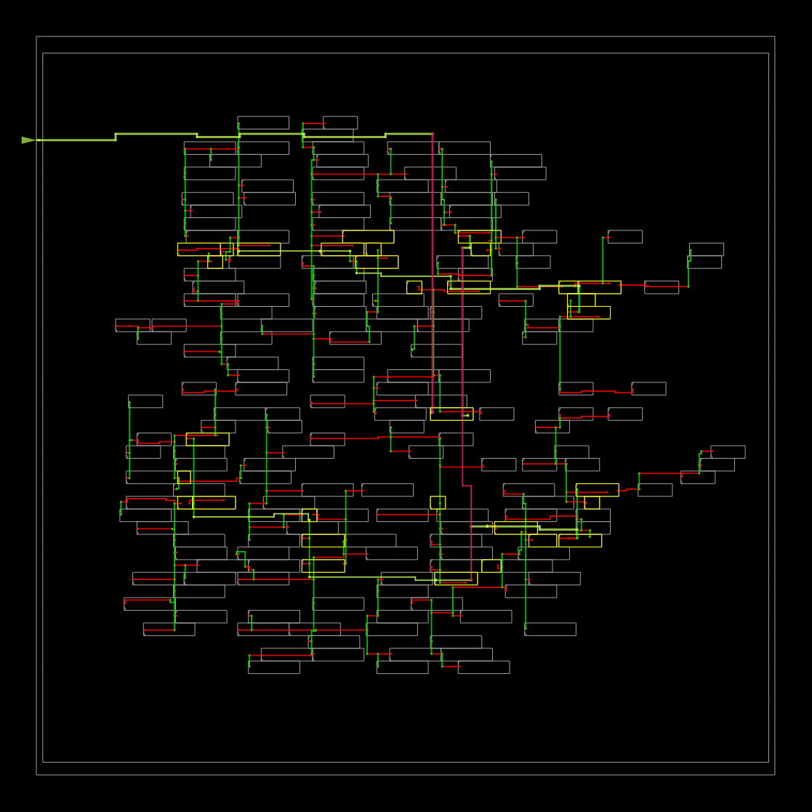
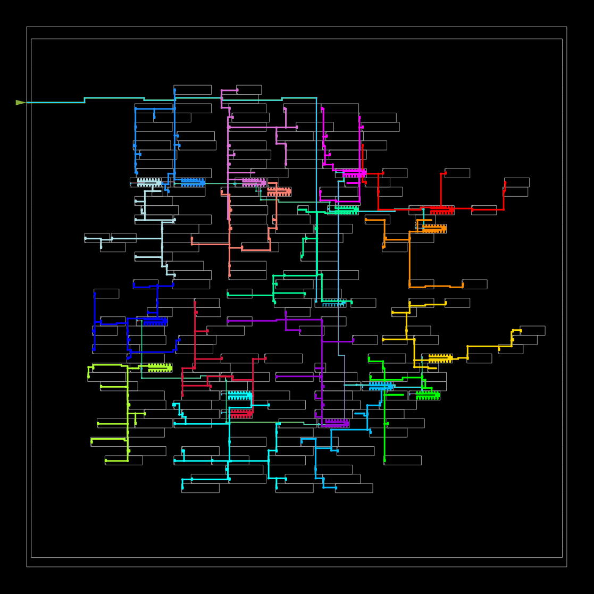
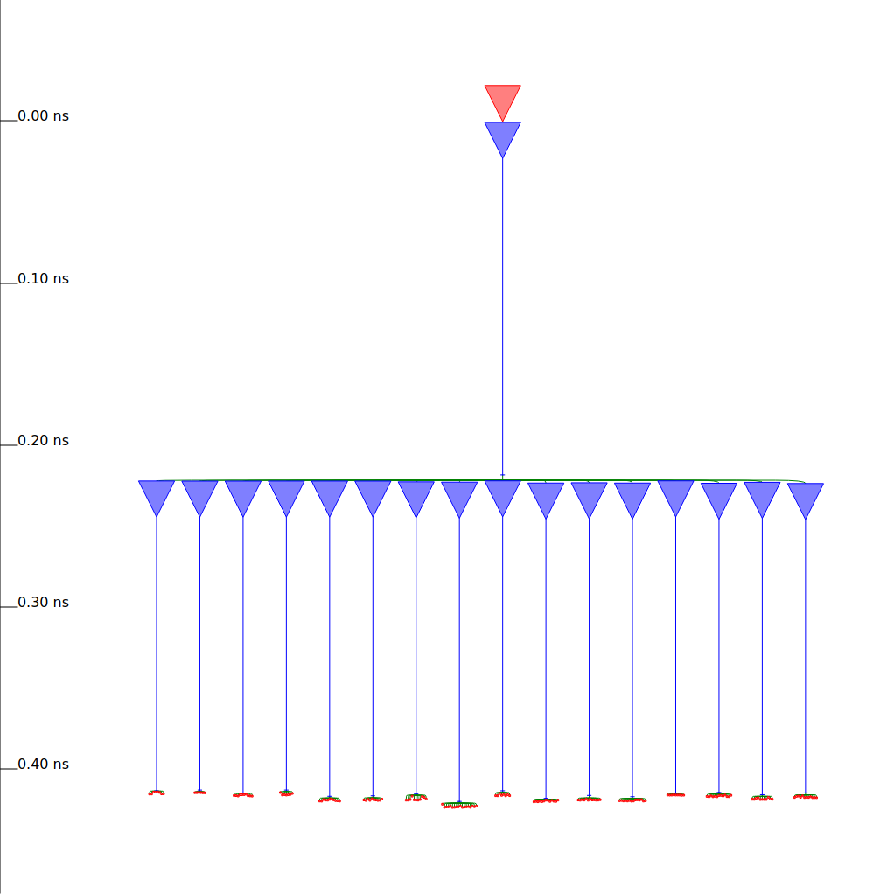
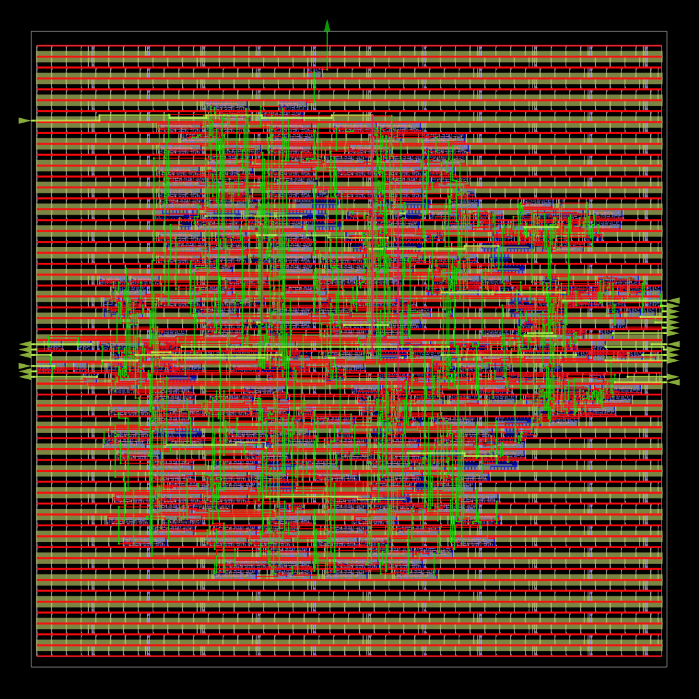
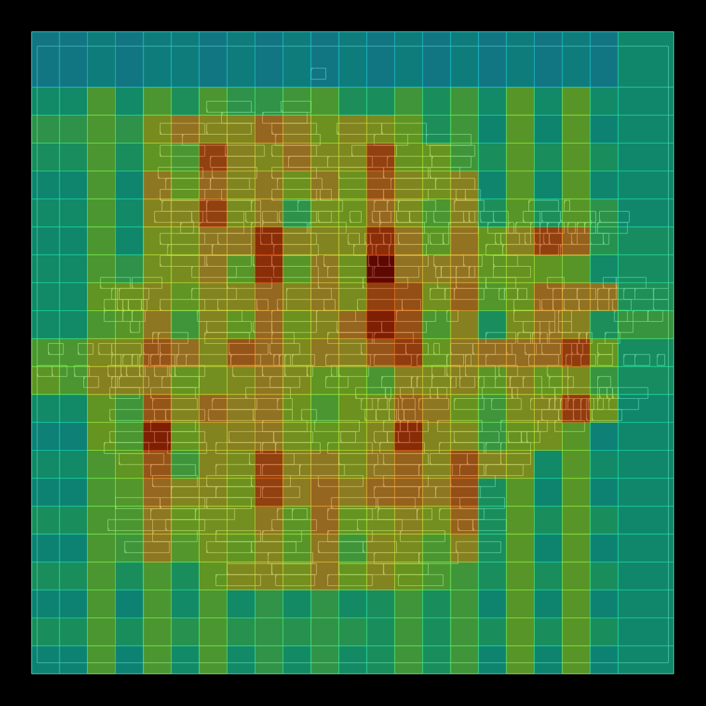
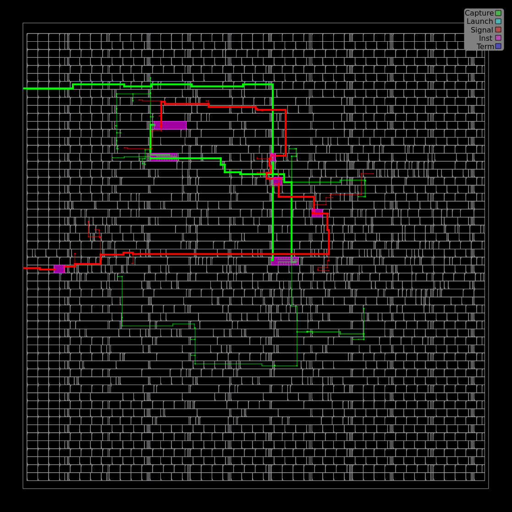

## Physical Design Results

The design was implemented using the OpenROAD physical-design flow with the SkyWater SKY130HD standard-cell library. The following views illustrate the major stages and results of the implementation.

### 1. Final Layout

This view provides an overall visualization of the completed physical design, including the placed cells, clock network, and routing.

### 2. Floorplan and Placement

This view shows the locations of standard cells after placement optimization. Placement aims to organize the cells efficiently while considering timing and routing requirements.

### 3. Clock Tree Synthesis (CTS)

This view illustrates the clock distribution network generated during CTS to deliver the clock signal to sequential elements with controlled timing differences.

This layout view highlights the physical arrangement of the clock-tree network within the design.

This view focuses on the clock-tree structure and its connections to the design's clock sinks.

### 4. Final Routing

This view shows the completed signal-routing stage, where interconnects are laid out to connect the design's cells and nets.

### 5. Routing Congestion

This view visualizes routing congestion, helping identify areas where routing resources are heavily utilized.

### 6. Worst Timing Path

This view highlights a critical timing path analyzed by the implementation flow. Timing analysis helps evaluate whether signal propagation meets the design's timing constraints.
